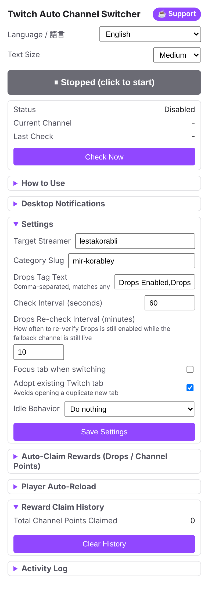

**English** | [繁體中文](README.zh-TW.md)

# Twitch Auto Channel Switcher

A Chrome extension for idling on Twitch. **When your favorite streamer goes live, it switches to their stream. When they're offline, it finds a Drops-enabled stream in the game category you choose. It claims Drops and channel points for you.** Leave it running in the background; you don't have to watch the screen.

---

## ☕ Support this project

This extension is free, open source and has no ads. If it saves you time watching streams and clicking "Claim", please consider buying me a coffee. Your support keeps it maintained and updated:

### 👉 [ko-fi.com/sagiriben](https://ko-fi.com/sagiriben)

There's also a **☕ Support** button at the top of the extension popup.

---

## Features

- ⭐ **Auto-switch when your streamer goes live.** It checks every 60 seconds by default and switches the tab as soon as they start streaming.
- 🎮 **Finds a Drops stream while they're offline.** It opens the game category you choose and picks a channel with Drops enabled. If the channel you're on is still live and still has Drops, it stays put, so your watch time isn't interrupted.
- 🎁 **Auto-claims Drops and channel points.** Rewards are claimed as soon as they're available. It keeps a claim history and a running total of channel points earned.
- 🔄 **Player watchdog.** It resumes paused video and clicks through "error #1000" and mature-content warnings. If the player freezes, it reloads the page. If a channel keeps failing, it skips that channel for a while and watches another one.
- 🌙 **Stable in the background.** Twitch keeps playing when the window is covered or minimized, or the screen is locked. The extension never steals focus or makes your taskbar flash.
- 🔔 **Desktop notifications (optional).** You get notified when it switches channels, claims a reward or hits an error.
- 🌐 **English / 繁體中文, switch anytime.** Use the **Language** menu at the top of the popup: Auto (browser language), 繁體中文 or English. The change applies instantly, including notifications and the activity log.
- 🔠 **Adjustable text size.** Choose from 5 text sizes for easier reading.

## ⚠️ Please read before using

To claim rewards reliably, this extension calls Twitch's **undocumented internal API** (the same one the Twitch website uses) and passes Twitch's anti-bot integrity check. This kind of automation **may violate the [Twitch Terms of Service](https://www.twitch.tv/p/en/legal/terms-of-service/)**, and Twitch could restrict or suspend your account.

**Use it at your own risk. You are responsible for any consequences of using this tool.** If you're worried about your account, turn off **Claim Channel Points Bonus** and **Enable auto-claim** in the settings and use only the auto-switching.

## Installation

1. Download the latest `twitch-auto-switch-vX.X.X.zip` from the [Releases page](../../releases/latest) and **unzip** it to a folder you won't delete.
   (Or click the green **Code → Download ZIP** button at the top of this page and unzip it.)
2. Open Chrome and go to `chrome://extensions`.
3. Turn on **Developer mode** (top-right corner).
4. Click **Load unpacked** and select the unzipped folder, the one that contains `manifest.json`.
5. Click the puzzle-piece icon in the toolbar and pin **Twitch Auto Channel Switcher** so it's easy to open.

> It also works in other Chromium-based browsers such as Edge and Brave (Chrome 111 or later, or equivalent). Install it the same way.

## Quick start

1. **Log into your Twitch account** in the browser. Auto-claiming requires being logged in.
2. Click the extension icon. If the popup isn't in English, change **Language / 語言** at the top to **English**.
3. Under **Settings**, fill in:
   - **Target Streamer**: the streamer's username, i.e. the part after `twitch.tv/`. For `twitch.tv/abc123`, enter `abc123`.
   - **Category Slug**: the game category to search for Drops streams while your streamer is offline. Open the game's category page; the slug is the part after `twitch.tv/directory/category/`. For `twitch.tv/directory/category/valorant`, enter `valorant`.
4. Click **Save Settings**.
5. Click **⏸ Stopped (click to start)** at the top. When it changes to **▶ Running**, the extension is working.

After a fresh install the extension is **stopped**, so it won't do anything until you start it.

## Settings

| Setting | Default | Description |
|---|---|---|
| Target Streamer | `lestakorabli` | The streamer you want to watch first. Change it to your own. |
| Category Slug | `mir-korabley` | The game category to search for Drops streams while your streamer is offline. Change it to your own. |
| Drops Tag Text | Drops Enabled, … | Comma-separated. A stream card showing any of these is treated as "Drops enabled". Add your own if your Twitch UI language uses different text. |
| Check Interval (seconds) | 60 | How often to check whether your streamer is live. Chrome limits this to about 1 minute minimum. |
| Drops Re-check Interval (minutes) | 10 | While watching a fallback channel, how often to re-check that Drops are still enabled. |
| Focus tab when switching | Off | Whether to bring the tab to the front when switching. Keep it off for background idling. |
| Adopt existing Twitch tab | On | Reuse a Twitch tab you already have open instead of opening a new one. |
| Idle Behavior | Do nothing | What to do when no stream qualifies: stay as is, or go back to the Twitch home page. |
| Enable auto-claim | On | Automatically claim Drops. |
| Claim Button Text | Claim, … | Button text used by the fallback claiming method. |
| Inventory Check Interval (minutes) | 5 | How often to check your Drops inventory for claimable rewards. |
| Claim Channel Points Bonus | On | Automatically claim channel-point bonus chests in chat. |
| Enable auto-reload | On | Automatically fix a frozen or broken player. |
| Stall Detection (seconds) | 45 | How long the video must be frozen before it counts as stuck. |
| Desktop notifications | On | Notify on channel switches, claimed rewards and errors. Takes effect instantly. |
| Language / 語言 | Auto | Auto (browser language), 繁體中文 or English. Takes effect instantly. |
| Text Size | Medium | Popup text size. Takes effect instantly. |

## FAQ

**Will it keep opening new Twitch tabs?**
No. It manages a single tab and switches channels by changing that tab's URL. Other Twitch tabs you open yourself are left alone.

**Will it keep reloading or switching away from the channel I'm watching?**
No. As long as the current channel is still live with Drops enabled, it leaves it alone. It only switches when your streamer goes live, the current channel goes offline, or Drops get turned off.

**It says "Streamer not found" or "Category not found".**
The username or category slug is misspelled. Copy the exact text from the URL, as described in [Quick start](#quick-start).

**It says "Could not find login credentials".**
You're not logged into Twitch, or your login expired. Log into Twitch again in the same browser.

**A reward is ready to claim, but it wasn't claimed automatically.**
Click the reload button on the extension in `chrome://extensions`, then click **Check Drops Inventory Now** in the popup. If it still doesn't work, please open an [issue](../../issues) and include the error messages from the popup's **Activity Log**.

**Does it keep running when my screen is locked?**
The extension makes Twitch believe the tab is always in the foreground, so the stream doesn't pause itself. But if your operating system freezes the whole browser while locked, that's outside the extension's control.

**Too many notifications?**
Uncheck the option under **Desktop Notifications**; it takes effect instantly. Routine player fixes never show notifications; they only go to the activity log.

## How it works

- **Live status:** uses the public GQL endpoint that the Twitch website itself uses.
- **Finding Drops streams:** opens the game category page and scans stream cards for the Drops tag (`content-directory.js`).
- **Claiming rewards (main method):** calls Twitch's internal GQL operations to query and claim Drops and channel points (`content-gql-claim.js`), and gets the token Twitch's anti-bot check requires from within the page (`page-integrity-bridge.js`).
- **Claiming rewards (fallback):** if the main method fails, it finds and clicks the "Claim" buttons on the Drops inventory page (`content-claim.js`, `content-inventory-claim.js`).
- **Keeping playback alive:** overrides the page's visibility state so Twitch doesn't pause in the background (`page-keep-active.js`), and watches the player to fix problems automatically (`content-player-watchdog.js`).
- **UI language switching:** `i18n.js` loads the chosen language's messages from `_locales/` into browser local storage. The popup, background notifications and content scripts all read their translations from there.

## Known limitations

- If Twitch changes its internal API, page layout or button text, some features may break until the extension is updated.
- Finding Drops streams relies on the text shown on the category page. If your Twitch UI language isn't covered by the defaults, add your own **Drops Tag Text** in the settings.
- This is not an official Twitch tool. See [Please read before using](#️-please-read-before-using).

## Privacy

- All settings and logs are stored **only in your own browser**. Nothing is uploaded to the developer or any third-party server.
- Your Twitch login credentials are only used inside your browser and sent directly to Twitch's official servers.
- No analytics or tracking code.

See the full [Privacy Policy](PRIVACY_POLICY.en.md).

## Translations

Want the extension in your language? Copy `_locales/en/messages.json` to `_locales/<your-locale>/messages.json` and translate the `message` values. Then add the locale to `SUPPORTED` in `i18n.js` and to the `<select id="uiLanguage">` menu in `popup.html`, and open a pull request. Contributions are welcome!

## Bug reports and suggestions

Found a bug or have an idea? Please open an [issue](../../issues). Including the messages from the popup's **Activity Log** helps a lot.

## License

[MIT License](LICENSE)
